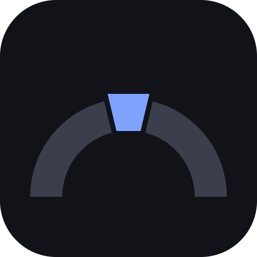

<div align="center">



# keystone-deck

**Presentaciones de alto impacto como código, para Claude Code.** Primero el guion, cada cifra con su fuente, una tesis por lámina, y todo en tu propia marca.

[](CHANGELOG.md)
[](LICENSE)
[](https://github.com/fsotosa-ops/keystone-deck/actions/workflows/ci.yml)
[](https://docs.claude.com/en/docs/claude-code/plugins)

[English](README.md) · [Español](README.es.md)


</div>

---

## Por qué

La mayoría de los decks generados con IA fallan igual: las láminas son listas de temas, las cifras no tienen fuente, todo está destacado y el orador lee la lámina. keystone-deck empaqueta un método que evita esas fallas en skills que Claude sigue solo, y agrega chequeos que hacen fallar el build cuando el método se rompe.

1. **El guion va primero.** `talk.md` es la fuente única del orden, las notas del orador y los tiempos. Cada lámina contesta la pregunta que dejó la anterior.
2. **Toda cifra se calcula y lleva fuente.** Los números viven en un registro de evidencia con su nivel (verificada, propia, supuesto o decisión) y llegan a las láminas solo como `{{fig:id}}`.
3. **La forma dice la relación.** Un ciclo se repite, un embudo filtra, una matriz posiciona. Cada lámina lleva un acento, una pieza destacada y unas 25 palabras visibles.
4. **Tu propia marca.** Un `brand.json` (W3C Design Tokens) se revisa por contraste y se compila para cada motor. Cambia la marca y cambian todas las salidas; el contenido no se mueve.

## Instalación

En Claude Code:

```text
/plugin marketplace add fsotosa-ops/keystone-deck
/plugin install keystone@keystone-deck
```

El plugin principal solo necesita Python 3.10 o superior.

## Inicio rápido

```text
/keystone:new revision-trimestral --brand preset:ocean
```

Claude pregunta quién es la audiencia y qué debe decidir, escribe `talk.md` y te muestra la secuencia de láminas antes de escribir `deck.json`. Después:

```text
/keystone:brand ruta/a/guia-de-marca.pdf    # o un sitio web, o preset:ink
/keystone:review revision-trimestral        # todos los chequeos y una revisión independiente
```

El guion acepta etiquetas en español (`En la lámina`, `Pasa a`, `Clic`, `Audiencia`, `Hilo`, `# Anexo`), y las skills responden a pedidos en español.

## Qué incluye

| Plugin | Estado | Qué hace | Requiere |
|---|---|---|---|
| `keystone` | **0.1** | Método, kit de marca, chequeos, andamiaje | Python 3.10+ |
| `keystone-html` | planificado | Deck en vivo 1920×1080 con pasos, vista de presentador, PDF con y sin notas, GitHub Pages | Python, Playwright |
| `keystone-slides` | planificado | Google Slides nativo y editable, armado con Apps Script | Node, Playwright, cuenta de Google |
| `keystone-video` | planificado | Video narrado desde el guion, con voz (ElevenLabs opcional), música que baja bajo la voz y chequeos de cuadros y audio | Node, Remotion, ffmpeg |

| Skill | Se activa cuando… |
|---|---|
| `narrative-arc` | planificas o arreglas una charla, pitch o deck, o el hilo parece una lista |
| `evidence-ledger` | pones cifras, proyecciones o citas en las láminas |
| `visual-grammar` | diseñas o criticas una lámina, eliges un diagrama o se ve recargada |
| `brand-kit` | quieres tus colores, tipografías o guía, o cambiar el tema |
| `render-review` | terminas cualquier cambio visual, antes de darlo por listo |

Comandos: `/keystone:new`, `/keystone:brand` y `/keystone:review`. Agente: `deck-critic`, un revisor de solo lectura.

## Tu propia marca

Una marca es un conjunto de *roles* de color que el método necesita (fondos, tinta, acento, destacado, estados), más tres roles tipográficos. Hay cuatro formas de obtenerla:
- un **preset** (`neutral`, `ink`, `ocean`, `warm`);
- **importarla de un sitio web**, leyendo sus estilos computados;
- **leerla de una guía en PDF**;
- **seis preguntas** que te hace Claude.

`brand check` revisa cada par de texto declarado contra WCAG 2.2, y `brand compile` se niega a compilar una marca que no pasa. El resultado es `brand.css`, `brand.gs`, `theme.ts`, `palette.py` y una hoja de muestra para aprobar. La referencia completa está en [docs/BRAND-TOKENS.md](docs/BRAND-TOKENS.md).

## Cómo funciona

Los motores son renderizadores sobre tres contratos (contenido, evidencia y marca), así que se pueden intercambiar. Un vocabulario común de doce layouts mantiene un mismo `deck.json` portable entre ellos. El diseño completo está en [docs/ARCHITECTURE.md](docs/ARCHITECTURE.md).

## Calidad, hoja de ruta y contribuciones

Las mismas que en el [README en inglés](README.md#quality). Licencia [MIT](LICENSE).
