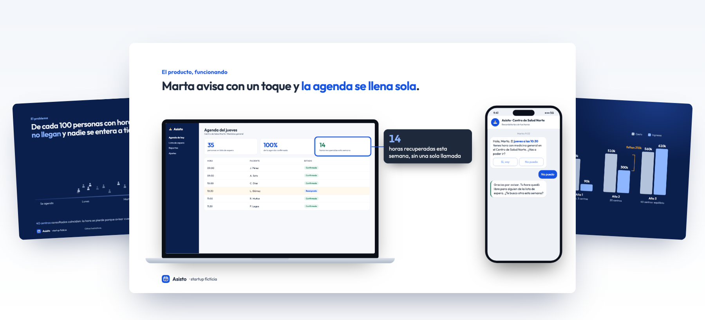

<div align="center">


# keystone-deck

**Presentaciones que dicen lo que quieres decir, como lo quieres decir.**<br>
Un plugin de Claude Code que convierte tu argumento, tus cifras y tu marca en un deck en vivo con movimiento, y lo exporta a PowerPoint.

[](CHANGELOG.md)
[](LICENSE)
[](https://docs.claude.com/en/docs/claude-code/plugins)

[English](README.md) · [Español](README.es.md)



</div>

## Por qué

Las herramientas de presentaciones deciden qué puedes decir. Eliges una plantilla y doblas la historia para que quepa en sus cajas: una lista de viñetas donde debería haber una persona, un gráfico genérico donde tus cifras deberían moverse, un menú de animaciones en vez del momento que necesitas mostrar.

keystone-deck lo da vuelta. Tú describes el argumento; Claude escribe el guion, revisa cada cifra y compone cada lámina como una escena hecha para ese punto: las personas que se quedan en el camino, el producto funcionando en las manos de alguien, la brecha en la proyección. El resultado corre en el navegador, se abre en PowerPoint y lleva tu marca.

<div align="center">

<br><sub>La lámina del producto en el pitch de ejemplo: el celular y el laptop son una maqueta en vivo, manejada clic a clic.</sub>
</div>

## Qué incluye

- **El guion antes que las láminas.** `talk.md` reúne la audiencia, el hilo en una oración y lo que dices en cada lámina. Cada lámina contesta la pregunta que dejó la anterior.
- **Cifras que puedes defender.** Las cifras viven en un registro de evidencia con su nivel (verificada, dato propio, supuesto, meta) y su fuente. Las láminas las referencian; nada se escribe a mano.
- **Escenas, no plantillas.** Quince escenas para decks de alto impacto: una persona en un día concreto, una población que se queda en el camino, problema y solución en espejo, el producto funcionando en dispositivos, la competencia en dos ejes, el mercado como presupuesto de quien paga, la tracción, proyecciones con la brecha rotulada y el pedido con uso de fondos. Cuando ninguna calza, Claude compone la lámina.
- **Tu marca, en todo.** Un solo `brand.json` (design tokens del W3C), revisado por contraste, mueve el deck en vivo, el PowerPoint y las figuras.
- **Un PowerPoint que conserva el movimiento.** Cada escena se graba en video y se pone en PowerPoint con los títulos como texto nativo editable y las notas del orador de tu guion. Quien nunca toca HTML solo lo abre y presenta.

## Instalación

En Claude Code:

```text
/plugin marketplace add fsotosa-ops/keystone-deck
/plugin install keystone@keystone-deck
/plugin install keystone-html@keystone-deck
/plugin install keystone-pptx@keystone-deck
```

| Plugin | Qué agrega | Requiere |
|---|---|---|
| `keystone` | El método: narrativa, evidencia, gramática visual, kit de marca, chequeos | Python 3.10+ |
| `keystone-html` | El motor de escenas | Python, Chrome |
| `keystone-pptx` | La exportación a PowerPoint con movimiento | Python, Chrome; `python-pptx`, `playwright`, `imageio-ffmpeg` con `uv run --with …` |

## Inicio rápido

```text
/keystone:new mi-pitch               # Claude pregunta quién decide y qué, y propone la secuencia de láminas
/keystone:brand ruta/a/guia.pdf      # o un sitio web, o preset:ocean
/keystone:review mi-pitch            # todos los chequeos y una revisión independiente
```

Después pide: *«ármalo como deck en vivo»* o *«expórtalo a PowerPoint»*.

## Tipos de presentación

Eliges el tipo y el método adapta el orden y las reglas:

| Tipo | Orden |
|---|---|
| **Pitch** | persona → problema con evidencia propia → solución en espejo → producto en contexto → por qué ahora → competencia → modelo → mercado → tracción → números → equipo → pedido |
| **Keynote** | un momento vivido → la tensión → el giro → tres ideas con una historia cada una → qué hacer el lunes → la frase que la gente repite |
| **Clase** | intuición → ejemplo con números → versión formal → pregunta de chequeo → trampas |
| **Informe** | la decisión que se necesita → qué cambió → evidencia → opciones → recomendación → próximos pasos |

## Cómo funciona

```text
   talk.md        evidence.json        brand.json
  (argumento)       (cifras)        (design tokens)
       └───────────── keystone check ─────────────┘
                           │
                 deck.json  →  escenas
                           │
          ┌────────────────┴────────────────┐
   deck en vivo (navegador)          PowerPoint (.pptx)
   pasos · presentador · producto    video por escena · texto nativo · notas
```

Tres contratos separan contenido, evidencia y marca, así que puedes cambiar la marca o la salida sin reescribir la historia. El detalle está en [docs/ARCHITECTURE.md](docs/ARCHITECTURE.md).

## Ejemplo

[`examples/pitch-asisto`](examples/pitch-asisto) es un pitch de inversión completo de 14 láminas para una startup ficticia: el guion, el registro de cifras, las láminas, una maqueta del producto con un celular y un panel de clínica, y los guiones de clics. Constrúyelo, preséntalo y expórtalo:

```bash
python3 plugins/keystone-html/scripts/build_stage.py examples/pitch-asisto
python3 -m http.server 8770 --directory examples/pitch-asisto/build   # abre /stage/
uv run --with playwright --with python-pptx --with imageio-ffmpeg \
  python plugins/keystone-pptx/scripts/build_pptx.py examples/pitch-asisto
```

## Preguntas frecuentes

**¿Funciona en claude.ai?** El método sí: las skills y los comandos cargan en claude.ai cuando agregas el plugin desde *Personalizar › Plugins*. Construir decks ejecuta scripts locales y un navegador, así que los motores necesitan Claude Code.

**¿Necesito saber programar?** No. Le hablas a Claude y él escribe los archivos. El resultado es un enlace para abrir en el navegador y un `.pptx` para presentar.

**¿Puedo editar el PowerPoint?** Los títulos, el texto y las notas son nativos y editables. La parte animada de cada lámina es un video; para cambiarla, se lo pides a Claude y exportas de nuevo.

**¿Mis datos salen de mi computador?** Los plugins corren en local. Las fuentes se cargan desde Google Fonts; nada más sale de tu equipo salvo que actives una integración.

## Contribuir

Los issues y pull requests son bienvenidos; revisa [CONTRIBUTING.md](CONTRIBUTING.md). Las escenas nuevas mantienen intactos los tres contratos y vienen con un ejemplo renderizado.

## Licencia

[MIT](LICENSE) · Creado por [Felipe Soto Santibáñez](https://github.com/fsotosa-ops).
