<div align="center">


# keystone-deck

**Presentaciones que dicen lo que quieres decir, como lo quieres decir.**<br>
Un plugin de Claude Code que convierte tu argumento, tus cifras y tu marca en un deck en vivo con movimiento, lo exporta a PowerPoint y lo narra en video con tu propia voz vía ElevenLabs.

[](CHANGELOG.md)
[](LICENSE)
[](#preguntas-frecuentes)
[](https://docs.claude.com/en/docs/claude-code/plugins)
[](#video-narrado-con-tu-voz)

[English](README.md) · [Español](README.es.md)

[Por qué](#por-qué) · [Instalación](#instalación) · [Escenas](#escenas) · [Cómo funciona](#cómo-funciona) · [Video narrado](#video-narrado-con-tu-voz) · [Ejemplos](#ejemplos) · [Comparación](#comparación) · [Preguntas](#preguntas-frecuentes)


</div>

## Por qué

Presentar es intentar que otro entienda lo que tú ya sabes: en una clase, una charla, un pitch o un informe. Las herramientas de presentaciones se ponen en medio. Deciden qué puedes decir. Eliges una plantilla y doblas la historia para que quepa en sus cajas: una lista de viñetas donde debería haber una persona, un gráfico genérico donde tus cifras deberían moverse, un menú de animaciones en vez del momento que necesitas mostrar.

keystone-deck lo da vuelta. Tú describes el argumento; Claude escribe el guion, revisa cada cifra y compone cada lámina como una escena hecha para ese punto: las personas que se quedan en el camino, el producto funcionando en las manos de alguien, la brecha en la proyección. El resultado corre en el navegador, se abre en PowerPoint y lleva tu marca.

<div align="center">
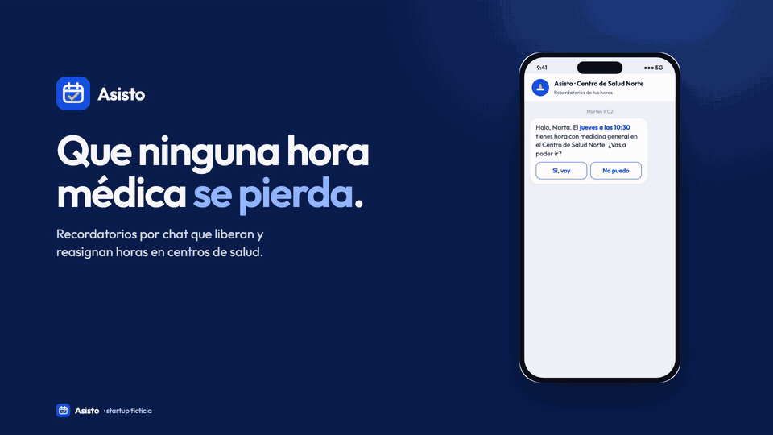
<br><sub>La lámina del producto en el pitch de ejemplo: el celular y el laptop son una maqueta en vivo, manejada clic a clic.</sub>
<br><br>
<a href="docs/assets/demo.mp4"><b>▶ Mira la demo narrada</b></a> <sub>(45 s, en español con subtítulos; sesiones reales en la terminal y en la app de Claude)</sub>
</div>

## Qué incluye

- **El guion antes que las láminas.** `talk.md` reúne la audiencia, el hilo en una oración y lo que dices en cada lámina. Cada lámina contesta la pregunta que dejó la anterior.
- **Cifras que puedes defender.** Las cifras viven en un registro de evidencia con su nivel (verificada, dato propio, supuesto, meta) y su fuente. Las láminas las referencian; nada se escribe a mano.
- **Escenas, no plantillas.** Dieciséis escenas para decks de alto impacto: una persona en un día concreto, una población que se queda en el camino, un mapa real donde se encienden lugares, problema y solución en espejo, el producto funcionando en dispositivos, la competencia en dos ejes, el mercado como presupuesto de quien paga, la tracción, proyecciones con la brecha rotulada y el pedido con uso de fondos. Cuando ninguna calza, Claude compone la lámina.
- **Tu marca, en todo.** Un solo `brand.json` (design tokens del W3C), revisado por contraste, mueve el deck en vivo, el PowerPoint y las figuras.
- **Tu guion, narrado.** El mismo guion se convierte en un video con tu voz clonada (ElevenLabs): cada escena dura lo que su frase y los clics caen cuando la voz los nombra.
- **Un PowerPoint que conserva el movimiento.** Cada escena se graba en video y se pone en PowerPoint con los títulos como texto nativo editable y las notas del orador de tu guion. Quien nunca toca HTML solo lo abre y presenta.

## Escenas

Cada lámina es una escena compuesta para su punto. El mapa viene del ejemplo rural y el resto del pitch de ejemplo, todos construidos por el plugin; `html` le permite a Claude componer cualquier otra.

| | | |
|---|---|---|
| 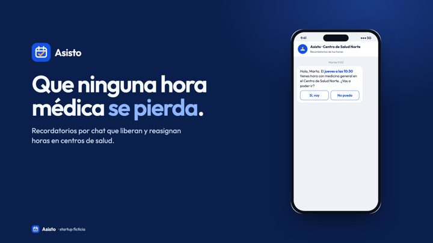 | 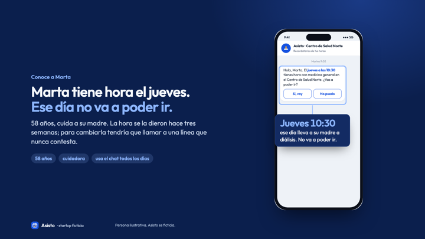 | 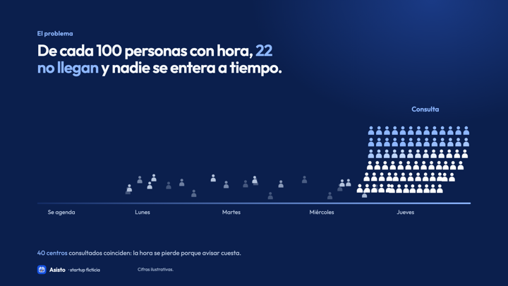 |
| `cover` · Portada | `persona` · Persona | `journey` · Población en el camino |
| 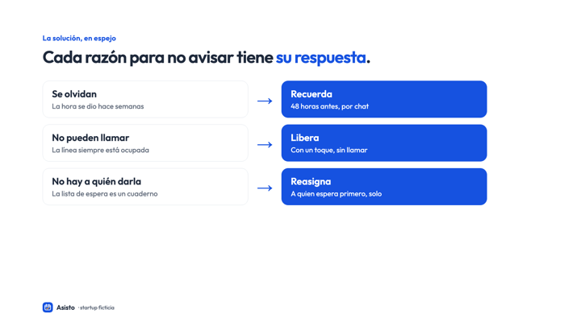 |  | 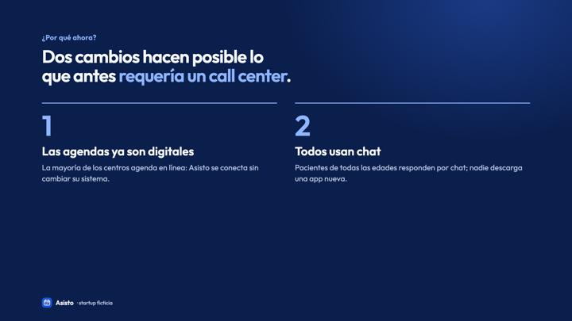 |
| `mirror` · Espejo | `product` · Producto en vivo | `why-now` · Por qué ahora |
| 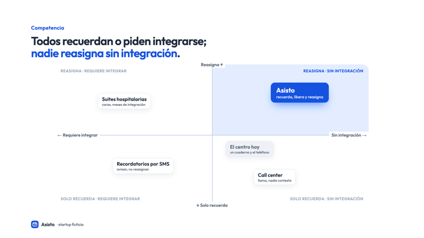 |  | 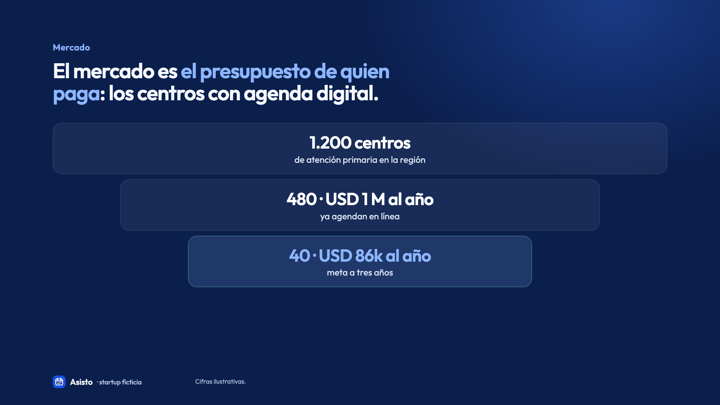 |
| `matrix` · Matriz | `model` · Modelo | `funnel` · Embudo |
| 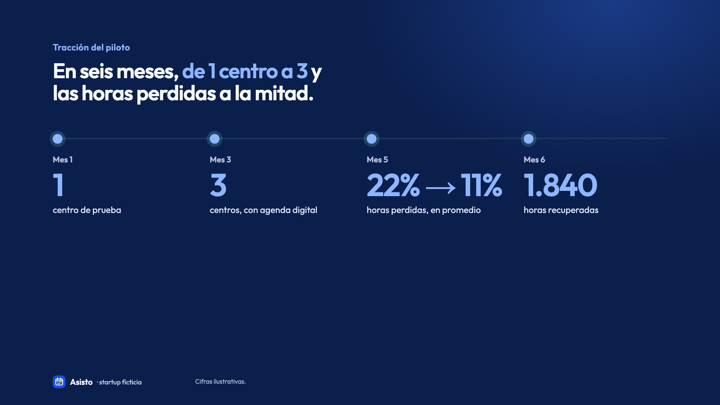 | 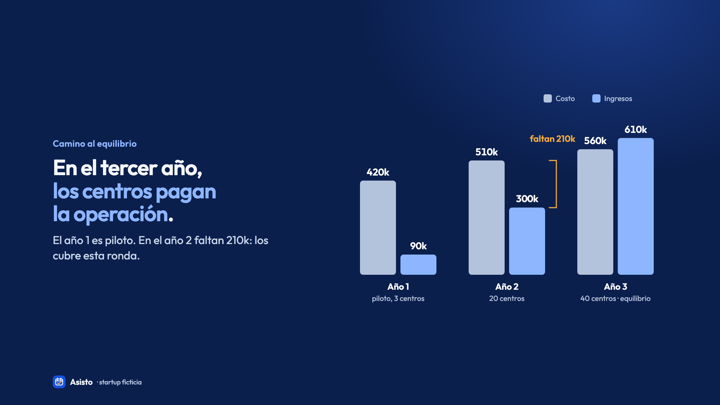 | 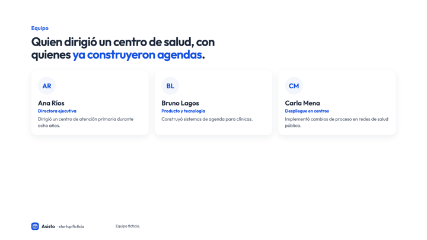 |
| `timeline` · Línea de tiempo | `projection` · Proyección | `team` · Equipo |
| 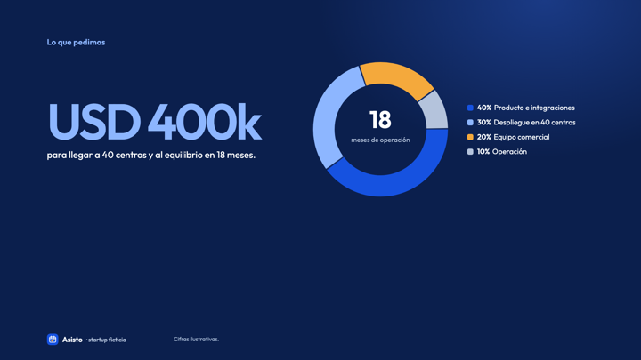 | 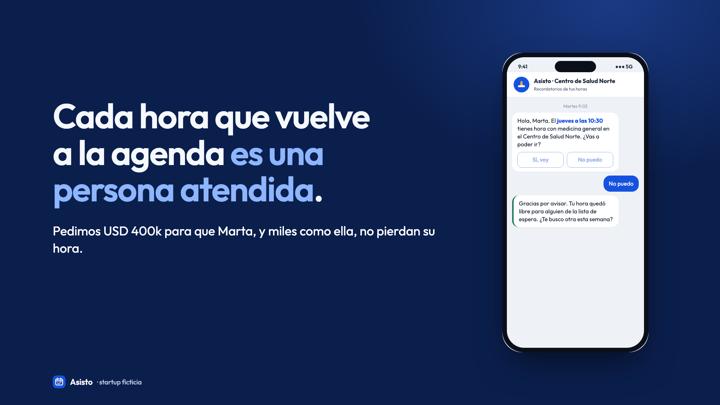 | 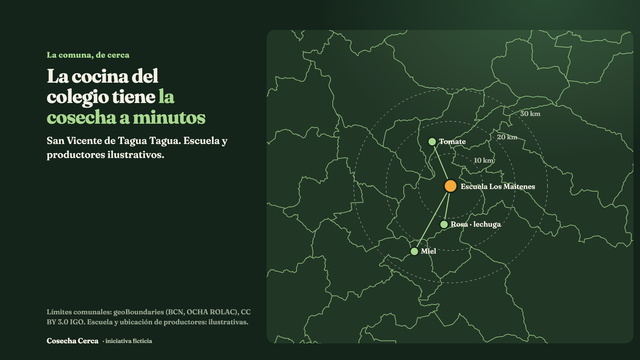 |
| `ask` · Pedido | `closing` · Cierre | `map` · Mapa |

Referencia completa: [skill `stage-deck`](plugins/keystone-html/skills/stage-deck/SKILL.md).

## Instalación

En Claude Code:

```text
/plugin marketplace add fsotosa-ops/keystone-deck
/plugin install keystone@keystone-deck
/plugin install keystone-html@keystone-deck
/plugin install keystone-pptx@keystone-deck
/plugin install keystone-video@keystone-deck
```

| Plugin | Qué agrega | Requiere |
|---|---|---|
| `keystone` | El método: narrativa, evidencia, gramática visual, kit de marca, chequeos | Python 3.10+ |
| `keystone-html` | El motor de escenas | Python, Chrome |
| `keystone-pptx` | La exportación a PowerPoint con movimiento | Python, Chrome; `python-pptx`, `playwright`, `imageio-ffmpeg` con `uv run --with …` |
| `keystone-video` | Un video narrado desde tu guion, con tu voz vía ElevenLabs | Python, Chrome, `imageio-ffmpeg`; opcional `ELEVENLABS_API_KEY` |

## Inicio rápido

```text
/keystone:new mi-pitch               # Claude pregunta quién decide y qué, y propone la secuencia de láminas
/keystone:brand ruta/a/guia.pdf      # o un sitio web, o preset:ocean
/keystone:review mi-pitch            # todos los chequeos y una revisión independiente
```

Después pide: *«ármalo como deck en vivo»* o *«expórtalo a PowerPoint»*.

## Tipos de presentación

Eliges el tipo y el método adapta el orden y las reglas:

| Tipo | Orden |
|---|---|
| **Pitch** | persona → problema con evidencia propia → solución en espejo → producto en contexto → por qué ahora → competencia → modelo → mercado → tracción → números → equipo → pedido |
| **Keynote** | un momento vivido → la tensión → el giro → tres ideas con una historia cada una → qué hacer el lunes → la frase que la gente repite |
| **Clase** | intuición → ejemplo con números → versión formal → pregunta de chequeo → trampas |
| **Informe** | la decisión que se necesita → qué cambió → evidencia → opciones → recomendación → próximos pasos |

## Video narrado con tu voz

`keystone-video` convierte el mismo guion en un video narrado, integrado con [ElevenLabs](https://elevenlabs.io):

1. Agrega tu voz a ElevenLabs (clonada o de su biblioteca) y define el tono en `deck.json`:
   ```json
   "voice": { "model": "eleven_v4", "direction": "cálida, segura, tono de charla" }
   ```
2. Exporta tu clave y el id de tu voz: `export ELEVENLABS_API_KEY=… ELEVENLABS_VOICE_ID=…`. Los dos se leen del entorno y nunca quedan en el deck, así que puedes compartirlo.
3. Pídele a Claude: *«haz un video narrado del deck»*.

Toda la narración se genera en una sola toma y se corta por lámina con las marcas de tiempo de cada palabra. Cada escena dura lo que su frase: las escenas leen cuánto dura la línea y ajustan su movimiento a ella, y los clics caen cuando la voz los nombra. Cada corte se transcribe y se compara con el guion, y el build falla si el video terminado tiene un silencio de más de 0,8 s. Con `--captions` el guion queda como subtítulos en el video, porque las redes lo reproducen en silencio. Sin clave, el video sale sin voz. Al volver a generarlo, solo se regraban las láminas que cambiaron.

> Declara las voces sintéticas. Los videos hechos así deberían decir que la voz fue generada con IA; la demo de arriba lo hace.

## Cómo funciona

```text
   talk.md        evidence.json        brand.json
  (argumento)       (cifras)        (design tokens)
       └───────────── keystone check ─────────────┘
                           │
                 deck.json  →  escenas
                           │
          ┌────────────────┴────────────────┐
   deck en vivo (navegador)          PowerPoint (.pptx)
   pasos · presentador · producto    video por escena · texto nativo · notas
```

Tres contratos separan contenido, evidencia y marca, así que puedes cambiar la marca o la salida sin reescribir la historia. El detalle está en [docs/ARCHITECTURE.md](docs/ARCHITECTURE.md).

## Ejemplos

[`examples/propuesta-rural`](examples/propuesta-rural) es una propuesta de 12 láminas para una iniciativa rural ficticia, armada por Claude a partir de un solo pedido: pequeños productores que venden directo a colegios y restoranes cercanos. Cada cifra viene de una fuente pública chilena citada en la lámina (ODEPA, INDAP, INE, SUBTEL), el mapa usa límites comunales reales y lo inventado está marcado como tal.

[`examples/pitch-asisto`](examples/pitch-asisto) es un pitch de inversión completo de 14 láminas para una startup ficticia: el guion, el registro de cifras, las láminas, una maqueta del producto con un celular y un panel de clínica, y los guiones de clics. Constrúyelo, preséntalo y expórtalo:

```bash
python3 plugins/keystone-html/scripts/build_stage.py examples/pitch-asisto
python3 -m http.server 8770 --directory examples/pitch-asisto/build   # abre /stage/
uv run --with playwright --with python-pptx --with imageio-ffmpeg \
  python plugins/keystone-pptx/scripts/build_pptx.py examples/pitch-asisto
```

## Comparación

| | keystone-deck | Generadores de láminas con IA (Gamma, Beautiful.ai, StarryKit) | Láminas como código (Slidev, reveal.js) | PowerPoint / Keynote |
|---|---|---|---|---|
| Parte de | tu argumento y tus cifras | un prompt o un documento | Markdown que escribes | una lámina en blanco |
| Chequeos de narrativa (hilo, fuentes, palabras por lámina) | sí, el build falla | no | no | no |
| Producto funcionando dentro de la lámina | sí, en vivo y guionado | capturas | posible, a mano | video o capturas |
| Tu marca | un archivo de tokens, con contraste revisado | tema o kit de marca | CSS | plantilla |
| Corre en local | sí | servicio en la nube | sí | sí |
| Salida | deck en vivo, PowerPoint con movimiento, video narrado | su editor, PPTX, PDF | web, PDF | PPTX, PDF, video |

Usa un generador de láminas con IA cuando necesitas muchas piezas bonitas rápido. Usa keystone-deck cuando la presentación tiene que sostenerse frente a un inversionista, un comité o una audiencia que va a cuestionar las cifras.

## Preguntas frecuentes

**¿Funciona en la app de Claude?** Sí. Agrega el marketplace desde *Personalización › Plugins › Agregar marketplace* con `fsotosa-ops/keystone-deck`, activa Keystone y Keystone html, y pide una presentación en el chat: Claude arma el deck en vivo como artefacto. La exportación a PowerPoint y el video narrado usan herramientas locales, así que necesitan Claude Code.

**¿Necesito saber programar?** No. Le hablas a Claude y él escribe los archivos. El resultado es un enlace para abrir en el navegador y un `.pptx` para presentar.

**¿Puedo editar el PowerPoint?** Los títulos, el texto y las notas son nativos y editables. La parte animada de cada lámina es un video; para cambiarla, se lo pides a Claude y exportas de nuevo.

**¿Qué tan maduro está?** Alpha. Probado en macOS con Chrome y Claude Code; Linux y Windows sin probar. Los tres contratos (guion, evidencia, marca) son estables; los campos de las escenas todavía pueden cambiar antes de la 1.0.

**¿Mis datos salen de mi computador?** Los plugins corren en local. Las fuentes se cargan desde Google Fonts; nada más sale de tu equipo salvo que actives una integración.

## Contribuir

Los issues y pull requests son bienvenidos; revisa [CONTRIBUTING.md](CONTRIBUTING.md). Las escenas nuevas mantienen intactos los tres contratos y vienen con un ejemplo renderizado.

## Licencia

[MIT](LICENSE) · Creado por [Felipe Soto Santibáñez](https://github.com/fsotosa-ops).
