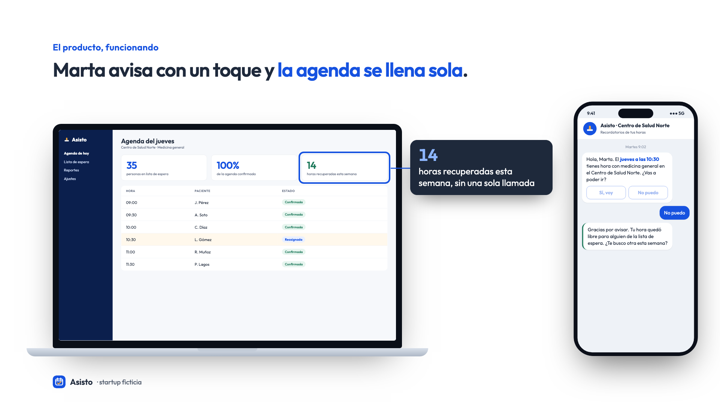
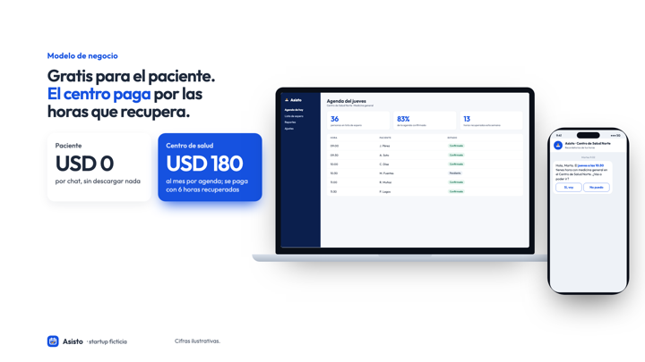

<div align="center">


# keystone-deck

**Presentations that say what you mean, the way you mean it.**<br>
A Claude Code plugin that turns your argument, your numbers and your brand into a live deck with motion, exports it to PowerPoint, and narrates it as a video with your own voice via ElevenLabs.

[](CHANGELOG.md)
[](LICENSE)
[](#faq)
[](https://docs.claude.com/en/docs/claude-code/plugins)
[](#narrated-video-with-your-voice)

[English](README.md) · [Español](README.es.md)

[Why](#why) · [Install](#install) · [Scenes](#scenes) · [How it works](#how-it-works) · [Narrated video](#narrated-video-with-your-voice) · [Example](#example) · [Compared](#how-it-compares) · [FAQ](#faq)


</div>

## Why

Slide tools decide what you can say. You pick a template, then bend the story to fit its boxes: a bullet list where a person should be, a stock chart where your numbers should move, an animation menu instead of the moment you need to show.

keystone-deck turns it around. You describe the argument; Claude writes the talk, checks every figure, and composes each slide as a scene built for that point: the people who drop out, the product running in someone's hands, the gap in the projection. The result runs in a browser, opens in PowerPoint, and wears your brand.

<div align="center">

<br><sub>The product slide of the example pitch: the phone and the laptop are a live mock, driven click by click.</sub>
</div>

## What you get

- **A talk before slides.** `talk.md` holds the audience, the one-sentence thread and what you say on each slide. Every slide answers the question the previous one left open.
- **Numbers you can defend.** Figures live in an evidence ledger with a tier (verified, own data, assumption, target) and a source. Slides reference them; nothing is typed by hand.
- **Scenes, not templates.** Fifteen scenes for high-impact decks: a person on a concrete day, a population that drops out, problem and solution in mirror, the product working in devices, competition on two axes, the market as the payer's budget, traction, projections with the gap labelled, the ask with use of funds. When none fits, Claude composes the slide.
- **Your brand, everywhere.** One `brand.json` (W3C design tokens), checked for contrast, drives the live deck, the PowerPoint and the figures.
- **Your talk, narrated.** The same talk becomes a video with your cloned voice (ElevenLabs): each scene lasts as long as its line and clicks fire on the spoken cue.
- **PowerPoint that keeps the motion.** Each scene is recorded to video and placed in PowerPoint with the titles as native, editable text and the speaker notes from your talk. People who never touch HTML just open it and present.

## Scenes

Every slide is a scene composed for its point. All fourteen below come from the example pitch, built by the plugin; `html` lets Claude compose anything else.

| | | |
|---|---|---|
|  |  |  |
| `cover` · Cover | `persona` · Persona | `journey` · Journey |
|  |  |  |
| `mirror` · Mirror | `product` · Product, live | `why-now` · Why now |
|  |  |  |
| `matrix` · Matrix | `model` · Model | `funnel` · Funnel |
|  |  |  |
| `timeline` · Timeline | `projection` · Projection | `team` · Team |
|  |  |
| `ask` · Ask | `closing` · Closing |

Full reference: [`stage-deck` skill](plugins/keystone-html/skills/stage-deck/SKILL.md).

## Install

In Claude Code:

```text
/plugin marketplace add fsotosa-ops/keystone-deck
/plugin install keystone@keystone-deck
/plugin install keystone-html@keystone-deck
/plugin install keystone-pptx@keystone-deck
/plugin install keystone-video@keystone-deck
```

| Plugin | What it adds | Needs |
|---|---|---|
| `keystone` | The method: narrative, evidence, visual grammar, brand kit, checks | Python 3.10+ |
| `keystone-html` | The stage engine and its scenes | Python, Chrome |
| `keystone-pptx` | PowerPoint export with motion | Python, Chrome; `python-pptx`, `playwright`, `imageio-ffmpeg` via `uv run --with …` |
| `keystone-video` | A narrated video from your talk, with your voice via ElevenLabs | Python, Chrome, `imageio-ffmpeg`; optional `ELEVENLABS_API_KEY` |

## Quickstart

```text
/keystone:new my-pitch          # Claude asks who decides and what, then proposes the slide sequence
/keystone:brand path/to/guide.pdf   # or a website, or preset:ocean
/keystone:review my-pitch       # every check, plus an independent critic
```

Then ask: *"build it as a live deck"* or *"export it to PowerPoint"*.

## Presentation types

Pick the type and the method adapts its order and rules:

| Type | Order |
|---|---|
| **Pitch** | person → problem with your own evidence → solution in mirror → product in context → why now → competition → model → market → traction → numbers → team → ask |
| **Keynote** | a lived moment → the tension → the turn → three ideas with a story each → what to do on Monday → the line people repeat |
| **Class** | intuition → worked example with numbers → formal version → check question → traps |
| **Report** | the decision needed → what changed → evidence → options → recommendation → next steps |

## Narrated video with your voice

`keystone-video` turns the same talk into a narrated video, integrated with [ElevenLabs](https://elevenlabs.io):

1. Add your voice to ElevenLabs (a cloned or a library voice) and put its id in `deck.json`:
   ```json
   "voice": { "id": "<voice id>", "model": "eleven_v4", "direction": "warm, confident, conference talk" }
   ```
2. Export your key: `export ELEVENLABS_API_KEY=…` (read from the environment, never written to disk).
3. Ask Claude: *"make a narrated video of the deck"*.

The whole talk is generated in one take and cut per slide by word timestamps, so each scene lasts as long as its line and clicks fire on the spoken cue. Each cut is transcribed and checked against the talk before the video is assembled. Without a key, the video comes out silent. Re-runs only re-record the slides that changed.

> Disclose synthetic voices. Videos made this way should say the voice was generated with AI; the demo above does.

## How it works

```text
   talk.md        evidence.json        brand.json
  (argument)       (figures)        (design tokens)
       └───────────── keystone check ─────────────┘
                           │
                 deck.json  →  scenes
                           │
          ┌────────────────┴────────────────┐
   live deck (browser)              PowerPoint (.pptx)
   steps · presenter view · product   video per scene · native text · notes
```

Three contracts keep content, evidence and brand apart, so you can change the brand or the output without rewriting the story. Details in [docs/ARCHITECTURE.md](docs/ARCHITECTURE.md).

## Example

[`examples/pitch-asisto`](examples/pitch-asisto) is a complete 14-slide investor pitch for a fictitious startup: the talk, the ledger, the slides, a mock product with a phone and a clinic dashboard, and the click scripts. Build it, present it, export it:

```bash
python3 plugins/keystone-html/scripts/build_stage.py examples/pitch-asisto
python3 -m http.server 8770 --directory examples/pitch-asisto/build   # open /stage/
uv run --with playwright --with python-pptx --with imageio-ffmpeg \
  python plugins/keystone-pptx/scripts/build_pptx.py examples/pitch-asisto
```

## How it compares

| | keystone-deck | AI slide generators (Gamma, Beautiful.ai, StarryKit) | Slides as code (Slidev, reveal.js) | PowerPoint / Keynote |
|---|---|---|---|---|
| Starts from | your argument and numbers | a prompt or a document | Markdown you write | a blank slide |
| Narrative checks (thread, sources, words per slide) | yes, the build fails | no | no | no |
| Product shown working inside the slide | yes, live and scripted | screenshots | possible, by hand | video or screenshots |
| Your brand | one token file, contrast-checked | theme or brand kit | CSS | template |
| Runs locally | yes | cloud service | yes | yes |
| Output | live deck, PowerPoint with motion, narrated video | their editor, PPTX, PDF | web, PDF | PPTX, PDF, video |

Use an AI slide generator when you need many good-looking pieces fast. Use keystone-deck when the presentation must hold up in front of an investor, a committee or an audience that will question the numbers.

## FAQ

**Does it work in claude.ai?** The method does: skills and commands load in claude.ai when you add the plugin from *Customize › Plugins*. Building decks runs local scripts and a browser, so the engines need Claude Code.

**Do I need to know code?** No. You talk to Claude; it writes the files. The output is a link to open in a browser and a `.pptx` to present.

**Can I edit the PowerPoint?** Titles, text and notes are native and editable. The animated part of each slide is a video; to change it, ask Claude and export again.

**How mature is it?** Alpha. Tested on macOS with Chrome and Claude Code; Linux and Windows are untested. The three contracts (talk, evidence, brand) are stable; scene fields may still change before 1.0.

**Is my data sent anywhere?** The plugins run locally. Fonts load from Google Fonts; nothing else leaves your machine unless you opt into an integration.

## Contributing

Issues and pull requests are welcome; see [CONTRIBUTING.md](CONTRIBUTING.md). New scenes keep the three contracts intact and come with a rendered example.

## License

[MIT](LICENSE) · Built by [Felipe Soto Santibáñez](https://github.com/fsotosa-ops).
